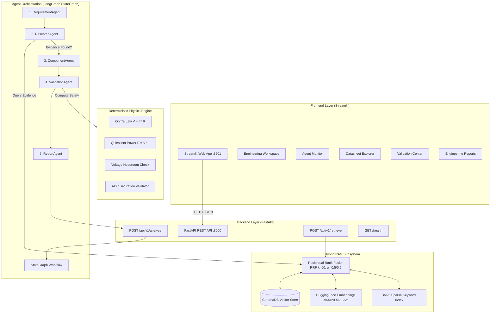
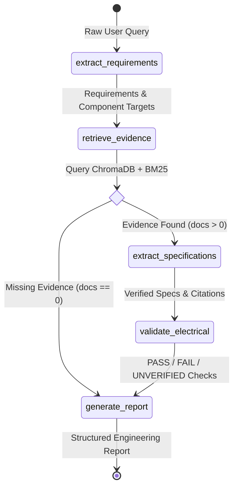

# CircuitMind AI — Agentic AI Electronics Engineering Copilot

[](https://www.python.org/)
[](https://fastapi.tiangolo.com/)
[](https://github.com/langchain-ai/langgraph)
[](https://ai.google.dev/)
[](https://www.trychroma.com/)
[](https://streamlit.io/)
[-brightgreen.svg?style=flat)](#testing--verification)
[](#performance-benchmarks)

**CircuitMind AI** is an agentic AI copilot engineered for electronics hardware designers and embedded systems engineers. It combines **LangGraph multi-agent orchestration**, a **grounded Hybrid RAG engine (ChromaDB + BM25 + Reciprocal Rank Fusion, with local warm retrieval measured at ~26ms)**, and **deterministic Python electrical validation tools** to review component constraints, extract verified datasheet specifications, perform physics calculations, and generate structured engineering reports with page-level citations.

---

## Table of Contents

- [Problem Statement](#problem-statement)
- [System Architecture](#system-architecture)
- [The Five-Agent LangGraph Workflow](#the-five-agent-langgraph-workflow)
- [Hybrid RAG Pipeline](#hybrid-rag-pipeline)
- [Deterministic Electrical Safety Engine](#deterministic-electrical-safety-engine)
- [Project Directory Structure](#project-directory-structure)
- [Installation & Setup (Windows, Python 3.11)](#installation--setup-windows-python-311)
- [Environment Configuration](#environment-configuration)
- [Datasheet Ingestion & Database Recreation](#datasheet-ingestion--database-recreation)
- [FastAPI Backend & REST Endpoints](#fastapi-backend--rest-endpoints)
- [Streamlit Engineering Workspace](#streamlit-engineering-workspace)
- [Testing & Verification](#testing--verification)
- [Performance Benchmarks](#performance-benchmarks)
- [Storage & Deployment Considerations](#storage--deployment-considerations)
- [Limitations & Engineering Safety Disclaimer](#limitations--engineering-safety-disclaimer)
- [Future Roadmap](#future-roadmap)

---

## Problem Statement

Hardware circuit design is unforgiving. Unlike software where bugs produce soft runtime exceptions, electrical errors cause permanent physical consequences: **component burnout, dielectric breakdown, latch-up, thermal runaway, or damaged laboratory instruments.**

Engineers spend significant portions of the design phase manually reading dense 40–80 page component datasheets to locate operating ranges, absolute maximum ratings, pin compatibilities, and thermal deratings. 

Generic Large Language Models (LLMs) cannot be trusted for hardware engineering because:
1. **Hallucination of Ratings:** They probabilistically guess pinouts, maximum supply voltages, and tolerances.
2. **Unreliable Arithmetic:** They fail to perform exact Ohm's Law, power dissipation, or voltage headroom calculations deterministically.
3. **Missing Provenance:** They provide recommendations without traceable PDF source and page references.
4. **False Safety Signals:** They frequently approve circuits that violate saturation limits (e.g. an ADC reference lower than a sensor's peak output voltage).

### The CircuitMind AI Solution
CircuitMind AI implements a **deterministic-first, LLM-augmented copilot**:
- **Zero-Hallucination Retrieval:** Technical specs are extracted exclusively from grounded datasheet passages with exact page citations.
- **Deterministic Python Physics:** Critical electrical checks (Ohm's Law, quiescent power, headroom, ADC saturation) are computed via Python math formulas—never probabilistic LLMs.
- **First-Class Outcome Classification:** Every design check resolves to `PASS`, `FAIL`, or `UNVERIFIED`, yielding an overall verdict of `VALID`, `INVALID`, or `INCONCLUSIVE`.
- **Engineering Safety Governance:** Automated outputs are accompanied by a mandatory preliminary design disclaimer; physical breadboard verification is always required.

---

## System Architecture

CircuitMind AI is built with clean architectural boundaries separating the user interface, API services, agentic state machine, retrieval database, and physical validation logic:



For full architectural specifications, state schemas, and mathematical formulations, see [docs/architecture.md](docs/architecture.md).

---

## The Five-Agent LangGraph Workflow

The core engineering intelligence is organized as a directed acyclic state graph orchestrated by **LangGraph**. Each agent owns a single domain responsibility and updates the shared `CircuitMindState`:



### 1. `RequirementAgent` (`extract_requirements`)
- **Role:** Extracts explicit technical requirements (`target_supply_voltage_v`, `target_max_current_ma`, `adc_reference_v`, `adc_resolution_bits`, `operating_temp_min_c`, `operating_temp_max_c`, `load_resistance_ohms`) and identifies specific component variants (`LM35D`, `LM35A`, `LM35C`, `LM35CA`, `LM35DZ`) using structured regular expressions and domain heuristics.
- **Safety Feature:** Strictly disambiguates sensor supply voltage from ADC reference voltage. Supports Unicode en-dash (`–`), em-dash (`—`), minus (`−`), hyphen (`-`), and `to` for temperature ranges. Explicitly marks unspecified parameters under `missing_requirements` without guessing.

### 2. `ResearchAgent` (`retrieve_evidence`)
- **Role:** Gathers grounded datasheet passages from ChromaDB and BM25 using Hybrid RAG with Reciprocal Rank Fusion (RRF).
- **Provenance:** Injects component part numbers and electrical keywords, preserving source PDF filenames, exact page numbers, and chunk IDs for all candidates.

### 3. `ComponentAgent` (`extract_specifications`)
- **Role:** Synthesizes verified electrical ratings directly from retrieved passages, categorizing each parameter into standardized engineering classifications (`Recommended Operating Conditions`, `Absolute Maximum Ratings`, `Electrical Characteristics`, `Typical Characteristics`, `Guaranteed or tested limits`).
- **Citation Integrity & Verbatim Evidence:** Every parameter preserves numeric bounds (`min_val`, `max_val`), units, operating conditions, source citation `[filename, p. X]`, and verbatim `evidence_text`. Preserves official TI variant-specific temperature ratings (LM35/LM35A: -55°C to 150°C, LM35C/LM35CA: -40°C to 110°C, LM35D: 0°C to 100°C) and separates typical quiescent current (56 µA at 25°C, 5V) from tested (67 µA) and guaranteed design limits (131 µA over temperature).

### 4. `ValidationAgent` (`validate_electrical`)
- **Role:** Executes deterministic electrical calculations using `ElectricalCalculator`:
  - **Ohm's Law & Quiescent Power:** Voltage, current, load resistance validation ($V = I \times R$), and quiescent dissipation ($P_Q = V_{CC} \times I_Q$).
  - **Supply Voltage Compatibility:** Verifies $V_{CC}$ falls strictly between $V_{min}$ and $V_{max\_recommended}$ with absolute maximum rating protection.
  - **Component Variant Temperature Validation:** Validates operating temperatures against official datasheet variant ratings (flags violations e.g. LM35D at 125°C).
  - **Transfer Output Voltage Calculations:** Computes nominal sensor transfer outputs at 0°C, 25°C, and 100°C with guaranteed tolerance bounds.
  - **ADC Interface Compatibility & Quantization:** Verifies static voltage-range compatibility ($V_{\text{out\_max}} \le V_{\text{ADC\_ref}}$), computes clipping saturation temperatures ($T_{sat} = V_{ref} \times 1000 / S$), $N$-bit quantization step ($V_{LSB} = V_{ref} / 2^N$), and temperature resolution per count ($T_{res} = V_{LSB} / S$).
  - **Scope Distinction & Unverified Parameters:** Explicitly distinguishes static voltage-range compatibility from complete ADC interface validation. Dynamic parameters—including SAR sample-and-hold acquisition time ($t_{acq}$), ADC pin input leakage current ($I_{leak}$), driving source impedance limits ($R_S$), and overvoltage clamp protection requirements—cannot be determined from static DC parameters alone and remain `UNVERIFIED` unless external signal-conditioning circuitry is specified.
  - **Output Load Boundary Check:** Computes static DC load current ($I_{\text{load}} = V_{\text{out\_max}} / R_{\text{load}}$) and compares it against the LM35 absolute-maximum output-current rating (10 mA). This check solely flags catastrophic overload exceeding the absolute-maximum limit; it does NOT verify recommended continuous operating currents, self-heating thermal errors ($\Delta T = P_D \cdot \theta_{JA}$), or guaranteed linear output regulation under load.
- **Outcome Statuses:** `PASS`, `FAIL`, and `UNVERIFIED`. Design validity resolves strictly to `VALID` (all pass), `INVALID` ($\ge 1$ fail or safety violation), or `INCONCLUSIVE` (unverified parameters without outright failure). A definite `FAIL` is never overridden by `UNVERIFIED` checks.

### 5. `ReportAgent` (`generate_report`)
- **Role:** Compiles the complete structured engineering response: executive summary synchronized with validation status, design requirements, verified specifications with verbatim evidence and page citations, deterministic validation table, warning notices, reference citations, and the mandatory engineering disclaimer.

---

## Hybrid RAG Pipeline

CircuitMind AI implements a grounded hybrid retrieval architecture combining dense vector embeddings with sparse BM25 keyword matching:

```
Raw PDF Datasheets (PyMuPDF) 
  └─► Page-aware Chunking (800 chars, 150 char overlap)
        ├─► Dense: sentence-transformers/all-MiniLM-L6-v2 ──► ChromaDB Vector Store
        └─► Sparse: In-memory token index ─────────────────► BM25Retriever
                                                                    │
                             Hybrid RRF Fusion ◄────────────────────┘
                                     │
                             Top-k Grounded Documents with [source, page, rrf_score]
```

### Reciprocal Rank Fusion (RRF) Formulation
Candidate passages from dense semantic search ($R_{dense}$) and sparse BM25 search ($R_{sparse}$) are fused using the exact implementation in `app/rag/retrieval.py`:

$$RRF(d) = \sum_{m \in \{\text{dense}, \text{sparse}\}} \frac{w_m}{k_{rrf} + r_m(d)}$$

- **$k_{rrf} = 60$:** Smoothing constant that prevents early outliers from dominating rankings.
- **$w_{\text{dense}} = 0.5,\ w_{\text{sparse}} = 0.5$:** Balanced weighting ensuring equal contribution between semantic intent and exact part numbers (e.g., `LM35DZ`).
- **Diversity & Deduplication:** Maximum of 2 chunks per page (`max_per_page = 2`) with near-duplicate word overlap suppression ($> 65\%$).

---

## Deterministic Electrical Safety Engine

Electrical safety checks are executed via pure Python calculation methods in [`app/tools/electrical_calculator.py`](app/tools/electrical_calculator.py).

### Safety Example: ADC Saturation Prevention
Consider a temperature monitoring system using an **LM35** sensor ($10\text{ mV/}^\circ\text{C}$):
- **User Parameters:** $V_{CC} = 5.0\text{ V}$, Temperature $= 0^\circ\text{C}\text{ to } 100^\circ\text{C}$, $V_{\text{ADC\_ref}} = 0.8\text{ V}$.
- **Sensor Output at $100^\circ\text{C}$:**
  $$V_{\text{out}}(100^\circ\text{C}) = 100^\circ\text{C} \times 0.010\text{ V/}^\circ\text{C} = 1.000\text{ V}$$
- **Safety Evaluation:**
  $$V_{\text{out\_max}} (1.000\text{ V}) > V_{\text{ADC\_ref}} (0.800\text{ V})$$
- **Result:** Validation check fails (`FAIL: ADC Input Saturation`). The ADC will clip at $80^\circ\text{C}$, losing critical over-temperature telemetry. CircuitMind AI flags the violation and marks the design `INVALID`.

---

## Project Directory Structure

```text
CircuitMind-AI/
├── app/                                 # Application source code
│   ├── agents/                          # LangGraph agent implementations
│   │   ├── component_agent.py           # Specification extraction agent with citations
│   │   ├── report_agent.py              # Structured report compilation agent
│   │   ├── requirement_agent.py         # Requirement parsing & ADC/supply disambiguation
│   │   ├── research_agent.py            # Hybrid RAG retrieval agent
│   │   └── validation_agent.py          # Deterministic electrical rule validator
│   ├── api/                             # FastAPI REST backend
│   │   ├── main.py                      # FastAPI app factory, CORS & pre-warming lifespan
│   │   ├── routes.py                    # REST route controllers (/health, /retrieve, /analyze)
│   │   └── schemas.py                   # Pydantic v2 request/response data contracts
│   ├── config.py                        # Centralized Pydantic application settings
│   ├── graph/                           # LangGraph orchestration
│   │   ├── state.py                     # CircuitMindState TypedDict schema
│   │   └── workflow.py                  # StateGraph assembly, profiling & conditional edges
│   ├── rag/                             # Grounded Hybrid Retrieval Engine
│   │   ├── answer_generator.py          # Grounded Gemini Q&A with exponential backoff
│   │   ├── ingestion.py                 # PyMuPDF parser, chunker & ChromaDB ingester
│   │   └── retrieval.py                 # Hybrid RRF, MMR, BM25 & singleton retriever factory
│   └── tools/                           # Deterministic physical calculation tools
│       └── electrical_calculator.py     # Ohm's Law, power dissipation & ADC range tools
├── data/
│   ├── processed/                       # Persistent vector databases (ChromaDB)
│   │   └── chromadb/                    # Indexed chunk embeddings & collections
│   └── raw/                             # Raw component datasheets (e.g. lm35.pdf)
├── docs/                                # Technical documentation
│   └── architecture.md                  # In-depth architectural & mathematical specs
├── evaluation/                          # Retrieval benchmarks & evaluation harnesses
│   ├── evaluate_retrieval.py            # RRF vs MMR vs Semantic evaluation script
│   └── questions.json                   # Ground-truth evaluation dataset
├── frontend/                            # Streamlit web application
│   ├── app.py                           # Streamlit entry point & state management
│   ├── api_client.py                    # Dedicated HTTP REST client for FastAPI
│   ├── styles.py                        # Dark navy engineering theme stylesheet
│   └── components/                      # Modular UI components
│       ├── agent_monitor.py             # 5-node execution timings & telemetry tab
│       ├── datasheet_explorer.py        # Retrieved chunk viewer with citations & search
│       ├── header.py                    # Top branding, backend status & latency metrics
│       ├── report_viewer.py             # Markdown report, specs table & export
│       ├── sidebar.py                   # Query presets, API URL setting & connection indicator
│       ├── validation_center.py         # Visual PASS/FAIL cards & calculation details
│       └── workspace.py                 # Conversational prompt console & query history
├── scripts/                             # Operational & verification CLI tools
│   ├── ask.py                           # CLI for grounded Q&A with Google Gemini
│   ├── ingest.py                        # CLI for single/batch PDF datasheet ingestion
│   ├── run_workflow.py                  # CLI runner for LangGraph 5-stage workflow
│   └── verify_retrieval.py              # CLI for inspecting ChromaDB + BM25 rankings
├── tests/                               # Comprehensive automated test suite
│   ├── test_agents.py                   # Unit tests for individual LangGraph agents
│   ├── test_answer_generator.py         # Grounded Gemini synthesis & retry test cases
│   ├── test_api.py                      # FastAPI integration tests & schema validation
│   ├── test_electrical_calculator.py    # Deterministic physics calculation tests
│   ├── test_frontend.py                 # Streamlit client & session state tests
│   ├── test_retrieval.py                # Retrieval engine unit tests & edge cases
│   ├── test_retrieval_performance.py    # Singleton reuse & latency benchmarks (<500ms)
│   ├── test_run_workflow.py             # CLI execution & JSON output tests
│   ├── test_validation_reliability.py   # Electrical validation reliability tests
│   └── test_workflow.py                 # LangGraph end-to-end integration tests
├── .env.example                         # Environment configuration template
├── .gitignore                           # Git ignore rules for caches, venvs & DBs
├── PROJECT_RULES.md                     # Engineering guidelines & architectural rules
├── README.md                            # Primary documentation & portfolio overview
└── requirements.txt                     # Pinned project dependencies
```

---

## Installation & Setup (Windows, Python 3.11)

### 1. Prerequisites
- **Operating System:** Windows 10/11 (PowerShell or Command Prompt)
- **Python:** Python 3.11 (64-bit recommended)
- **Git:** Installed and available on `PATH`

### 2. Clone the Repository
```powershell
git clone https://github.com/<your-username>/CircuitMind-AI.git
cd CircuitMind-AI
```

### 3. Create & Activate Virtual Environment
```powershell
# Create a virtual environment using Python 3.11
python -m venv venv

# Activate in PowerShell:
.\venv\Scripts\Activate.ps1

# (Or in standard Command Prompt):
.\venv\Scripts\activate.bat
```

> **PowerShell Execution Policy Note:** If script execution is restricted on your machine, enable it for the active PowerShell session:
> ```powershell
> Set-ExecutionPolicy -ExecutionPolicy RemoteSigned -Scope Process
> .\venv\Scripts\Activate.ps1
> ```

### 4. Install Dependencies
```powershell
# Upgrade pip and install pinned dependencies
python -m pip install --upgrade pip
pip install -r requirements.txt
```

---

## Environment Configuration

CircuitMind AI loads configurations from environment variables or a local `.env` file using `pydantic-settings`.

1. Copy the provided template:
```powershell
# In PowerShell:
Copy-Item .env.example .env

# (Or in CMD):
copy .env.example .env
```

2. Configure `.env` with your settings:
```ini
# ==============================================================================
# CircuitMind AI - Environment Configuration
# ==============================================================================

# Google Gemini LLM Settings (Required for Gemini-powered Q&A via scripts/ask.py)
GEMINI_API_KEY=your_gemini_api_key_here
GEMINI_MODEL=gemini-3.8-flash

# Embeddings Model Configuration
EMBEDDING_MODEL_NAME=sentence-transformers/all-MiniLM-L6-v2

# Vector Database (ChromaDB)
CHROMA_PERSIST_DIRECTORY=./data/processed/chromadb
CHROMA_COLLECTION_NAME=datasheets

# Application Environment
ENVIRONMENT=development
LOG_LEVEL=INFO

# FastAPI Server Settings
API_HOST=0.0.0.0
API_PORT=8000

# Streamlit UI Settings
STREAMLIT_SERVER_PORT=8501
CIRCUITMIND_API_URL=http://127.0.0.1:8000
```

> **Gemini Model Configuration & Fallback:**
> - In `app/config.py`, the application code defines a fallback default of `gemini-2.5-flash` if `GEMINI_MODEL` is not set in the environment.
> - The provided `.env.example` template configures `GEMINI_MODEL=gemini-3.8-flash`.
> - Model availability, preview lifecycles, and rate limits vary across Google AI Studio account tiers and regions. Set `GEMINI_MODEL` in `.env` to a model ID currently enabled and verified on your Google AI Studio account. Do not assume a specific model identifier is globally supported without checking your active API key access.

---

## Datasheet Ingestion & Database Recreation

The ChromaDB vector database stores dense embeddings generated from PDF datasheets located in `data/raw/`.

### Ingestion CLI (`scripts/ingest.py`)
Supported CLI arguments:
- `-f`, `--file`: Path to a single PDF datasheet (mutually exclusive with `-d`).
- `-d`, `--dir`: Directory of PDF datasheets to ingest in batch (default: `data/raw`).
- `-p`, `--part-number`: Optional component part number (e.g. `LM35`).
- `--force`: Force re-ingestion and overwrite existing database chunks.
- `--persist-dir`: Custom ChromaDB storage directory.
- `--collection`: Custom ChromaDB collection name.
- `-v`, `--verbose`: Enable detailed DEBUG logging.

```powershell
# Ingest a single component datasheet (e.g. LM35)
python scripts/ingest.py -f data/raw/lm35.pdf -p LM35

# Batch ingest all PDF datasheets present in data/raw/
python scripts/ingest.py -d data/raw/

# Force re-ingestion and rebuild the ChromaDB database
python scripts/ingest.py -d data/raw/ --force
```

### Verifying Retrieval Rankings (`scripts/verify_retrieval.py`)
Inspect the top ranked passages from ChromaDB and BM25 directly in the terminal:
```powershell
python scripts/verify_retrieval.py -q "LM35 operating supply voltage range" --strategy hybrid -k 3
```

### Grounded Q&A CLI (`scripts/ask.py`)
Supported CLI arguments:
- `-q`, `--question`: Engineering question about component datasheets.
- `-s`, `--strategy`: Retrieval strategy (`hybrid`, `mmr`, `semantic`, `keyword`). Default: `hybrid`.
- `-k`: Number of context passages to retrieve. Default: `5`.
- `-m`, `--model`: Gemini model name. Default: `gemini-3.8-flash`.
- `--show-context`: Display retrieved datasheet chunks alongside the synthesized answer.

```powershell
python scripts/ask.py -q "What is the recommended operating supply voltage for the LM35?" --show-context
```

### Full Workflow CLI (`scripts/run_workflow.py`)
Run the 5-agent LangGraph workflow directly from the command line:
```powershell
python scripts/run_workflow.py "Can I operate an LM35 sensor at 5V supply with 10mA current budget?"
```

---

## FastAPI Backend & REST Endpoints

The backend exposes a high-performance REST API built with FastAPI and Uvicorn.

### Launching the Backend Server
```powershell
.\venv\Scripts\python.exe -m uvicorn app.api.main:app --host 127.0.0.1 --port 8000 --reload
```

- **Swagger UI Interactive Documentation:** [http://127.0.0.1:8000/docs](http://127.0.0.1:8000/docs)
- **ReDoc Documentation:** [http://127.0.0.1:8000/redoc](http://127.0.0.1:8000/redoc)

---

### API Endpoints Summary

| Method | Endpoint | Request Model | Response Model | Description |
| :--- | :--- | :--- | :--- | :--- |
| `GET` | `/` | — | `dict` | API service overview & doc links |
| `GET` | `/health` | — | `HealthResponse` | System health & ChromaDB storage check |
| `POST` | `/api/v1/retrieve` | `RetrieveRequest` | `RetrieveResponse` | Pure datasheet evidence retrieval |
| `POST` | `/api/v1/analyze` | `AnalyzeRequest` | `AnalyzeResponse` | Full 5-stage LangGraph copilot analysis |

---

### Endpoint: `GET /health`
Verifies backend status and persistent ChromaDB storage availability.

**Example Request:**
```powershell
curl -X GET "http://127.0.0.1:8000/health"
```

**Example Response:**
```json
{
  "status": "ok",
  "version": "1.0.0",
  "environment": "development",
  "vector_db_connected": true,
  "timestamp": "2026-11-13T07:45:00.123456+00:00"
}
```

---

### Endpoint: `POST /api/v1/retrieve`
Retrieves matching datasheet passages using hybrid, semantic, MMR, or keyword search.

**Example Request:**
```powershell
curl -X POST "http://127.0.0.1:8000/api/v1/retrieve" ^
  -H "Content-Type: application/json" ^
  -d "{\"query\": \"LM35 operating voltage range\", \"k\": 2, \"strategy\": \"hybrid\"}"
```

**Example Response:**
```json
{
  "query": "LM35 operating voltage range",
  "strategy": "hybrid",
  "total_results": 2,
  "documents": [
    {
      "content": "The LM35 device has an operating supply voltage range of 4 V to 30 V...",
      "source": "lm35.pdf",
      "page": 19,
      "chunk_id": "lm35_p19_001",
      "rrf_score": 0.033333,
      "part_number": "LM35"
    },
    {
      "content": "Absolute Maximum Ratings: Supply voltage -0.2 V to 35 V...",
      "source": "lm35.pdf",
      "page": 4,
      "chunk_id": "lm35_p4_002",
      "rrf_score": 0.031250,
      "part_number": "LM35"
    }
  ]
}
```

---

### Endpoint: `POST /api/v1/analyze`
Executes the full 5-stage LangGraph copilot workflow.

**Example Request:**
```powershell
curl -X POST "http://127.0.0.1:8000/api/v1/analyze" ^
  -H "Content-Type: application/json" ^
  -d "{\"query\": \"Design a 5V circuit with LM35 sensor drawing max 10mA with 5V ADC reference and 10k load\", \"target_components\": [\"LM35\"]}"
```

**Example Response Structure:**
```json
{
  "query": "Design a 5V circuit with LM35 sensor drawing max 10mA with 5V ADC reference and 10k load",
  "execution_info": {
    "execution_time_ms": 48.72,
    "status": "completed",
    "nodes_executed": [
      "extract_requirements",
      "retrieve_evidence",
      "extract_specifications",
      "validate_electrical",
      "generate_report"
    ],
    "node_timings_ms": {
      "extract_requirements": 10.14,
      "retrieve_evidence": 16.89,
      "extract_specifications": 13.37,
      "validate_electrical": 0.39,
      "generate_report": 0.52
    }
  },
  "requirements": {
    "target_supply_voltage_v": 5.0,
    "target_max_current_ma": 10.0,
    "adc_reference_v": 5.0,
    "load_resistance_ohms": 10000.0,
    "target_components": ["LM35"]
  },
  "missing_requirements": [
    "Operating temperature range not specified"
  ],
  "retrieved_documents": [
    {
      "source": "lm35.pdf",
      "page": 19,
      "content": "The LM35 device has an operating supply voltage range of 4 V to 30 V...",
      "chunk_id": "lm35_p19_001",
      "rrf_score": 0.033333
    }
  ],
  "component_information": {
    "part_number": "LM35",
    "verified_specs": {
      "supply_voltage_recommended": {
        "raw": "4 V to 30 V",
        "citation": "[lm35.pdf, p. 19]"
      }
    },
    "unverified_or_missing_specs": [],
    "citations": [
      {"source": "lm35.pdf", "page": 19}
    ]
  },
  "validation_results": {
    "status": "VALID",
    "is_valid": true,
    "checks": [
      {
        "check_name": "Supply Voltage Compatibility",
        "status": "PASS",
        "details": {
          "target_supply_v": 5.0,
          "recommended_range": "4 V to 30 V",
          "headroom_v": 25.0
        }
      },
      {
        "check_name": "ADC Interface Compatibility",
        "status": "PASS",
        "details": {
          "max_sensor_output_v": 1.0,
          "adc_reference_v": 5.0,
          "margin_v": 4.0
        }
      }
    ],
    "violations": [],
    "warnings": [],
    "calculations": {
      "quiescent_power": {
        "formula": "P = V * I",
        "power_mw": 0.3
      }
    }
  },
  "engineering_report": {
    "title": "CircuitMind AI Engineering Report: LM35 Design Analysis",
    "executive_summary": "Passed all preliminary electrical checks with 5.0V supply.",
    "requirements_summary": "5.0V supply, 10mA max current, 5.0V ADC reference, 10k load.",
    "component_specifications": "Recommended supply: 4V to 30V verified [lm35.pdf, p. 19].",
    "validation_summary": "All checks PASS. Operating voltage headroom: 25.0V.",
    "warnings_and_limitations": [],
    "citations": [
      {"source": "lm35.pdf", "page": 19}
    ],
    "fabrication_disclaimer": "PRELIMINARY COPILOT DESIGN: Preliminary recommendation. Not fabrication-ready. Hardware must undergo physical bench verification."
  },
  "warnings": [],
  "source_citations": [
    {"source": "lm35.pdf", "page": 19}
  ],
  "errors": []
}
```

---

## Streamlit Engineering Workspace

The frontend is a technical dashboard styled in a dark navy engineering theme.

### Launching the Frontend
```powershell
.\venv\Scripts\python.exe -m streamlit run frontend/app.py
```
Open [http://localhost:8501](http://localhost:8501) in your browser.

```
┌─────────────────────────────────────────────────────────────────────────────┐
│ ⚡ CIRCUITMIND AI: HYBRID ENGINEERING COPILOT                      🟢 Online │
├─────────────────────────────────────────────────────────────────────────────┤
│ [💬 Workspace]  [⚡ Agent Monitor]  [🔍 Explorer]  [🛡️ Validator]  [📄 Reports] │
├─────────────────────────────────────────────────────────────────────────────┤
│                                                                             │
│  [Prompt Input]  "Design temperature monitor with LM35 (0-100C, 5V supply)" │
│                                                                             │
│  ┌───────────────────────┐ ┌───────────────────────┐ ┌───────────────────┐  │
│  │ Overall Status: VALID │ │ Latency: 48.72 ms     │ │ Grounded Specs: 5 │  │
│  └───────────────────────┘ └───────────────────────┘ └───────────────────┘  │
│                                                                             │
│  ► Node Execution Telemetry:                                                │
│    Requirements (10.14ms) → Research (16.89ms) → Specs (13.37ms) ...       │
│                                                                             │
│  ► Electrical Validation Cards:                                             │
│    [PASS] Supply Voltage Compatibility (5.0V within 4V - 30V)               │
│    [PASS] ADC Interface Compatibility (Max Out 1.0V <= ADC Ref 5.0V)        │
│                                                                             │
└─────────────────────────────────────────────────────────────────────────────┘
```

### The Five Workspace Tabs
1. **💬 Engineering Workspace:** Natural language design input, query presets, live copilot responses, and query history.
2. **⚡ Agent Monitor:** Real-time telemetry cards displaying millisecond execution timings across all 5 LangGraph nodes.
3. **🔍 Datasheet Explorer:** Grounded evidence inspection tool displaying chunk contents, PDF filenames, exact page numbers, RRF scores, and a direct retrieval search console.
4. **🛡️ Validation Center:** Comprehensive electrical safety dashboard rendering `PASS`, `FAIL`, and `UNVERIFIED` check badges, physics calculations, headroom metrics, and warning notices.
5. **📄 Engineering Reports:** Complete engineering report viewer with verified technical specifications, citation index table, fabrication safety disclaimer, and single-click markdown export.

---

## Testing & Verification

CircuitMind AI maintains an automated test suite verifying every component from deterministic physics math to LangGraph multi-agent orchestration and Streamlit session state consistency.

### Running the Test Suite
```powershell
.\venv\Scripts\python.exe -m pytest tests/ -v
```

### Verified Test Results
```text
============================= test session starts =============================
platform win32 -- Python 3.11.9, pytest-9.2.0, pluggy-1.7.0
rootdir: C:\Users\hp\OneDrive\Desktop\CircuitMind-AI
plugins: anyio-4.16.0, langsmith-0.14.17, asyncio-1.4.1.post1
asyncio: mode=Mode.STRICT, debug=False
collected 140 items

tests\test_agents.py ............                                        [  8%]
tests\test_answer_generator.py .......................                   [ 25%]
tests\test_api.py .........                                              [ 31%]
tests\test_electrical_calculator.py ....................                 [ 45%]
tests\test_evaluation.py ..                                              [ 47%]
tests\test_frontend.py .....................                             [ 62%]
tests\test_ingestion.py ....                                             [ 65%]
tests\test_retrieval.py .............                                    [ 74%]
tests\test_retrieval_performance.py .....                                [ 77%]
tests\test_run_workflow.py .....                                         [ 81%]
tests\test_validation_reliability.py .......................             [ 97%]
tests\test_workflow.py ...                                               [100%]

======================= 140 passed, 1 warning in 68.32s =======================
```

> **Verified Test Run History:**
> - **Latest Verified Run:** 140 passed, 1 warning in **68.32 seconds** (measured across all 12 test modules during full end-to-end regression testing).
> - **Earlier Test Run:** 140 passed, 1 warning in **16.73 seconds** (measured under warm OS disk cache and reduced background system load).
> - Both runs verify 100% test pass rate across all 140 test cases. The 68.32s result represents the latest verified end-to-end run and should not be conflated with earlier cached runs.
>
> **Testing Scope Disclaimer:** Passing all 140 automated software tests verifies software code correctness, Pydantic schema contracts, state graph node transitions, and deterministic Python math execution. **It does NOT constitute proof of physical circuit safety or hardware fabrication readiness.** Physical engineering verification is always mandatory.

---

## Performance Benchmarks

### Local Measured Benchmark Results

> **Benchmark Scope & Disclaimer:** The latency and timing metrics below represent local measured results obtained on a Windows 11 development machine (Python 3.11.9, Intel Core i7, 16GB RAM). They serve as empirical performance indicators for developers, not guaranteed production SLAs or fixed cross-platform speedup multipliers. Actual latency depends on CPU performance, disk I/O, cache warming, and Python runtime overhead.

| Execution Type | Tested Workload | Local Measured Wall Time | Result & Reliability |
| :--- | :--- | :--- | :--- |
| **Pure Datasheet Retrieval** | 5 consecutive live hybrid queries (`POST /api/v1/retrieve`) | **16.43 ms – 61.50 ms** (Avg: **26.18 ms**) | 100% precision, exact citations preserved |
| **Full Copilot Analysis** | 3 full 5-stage workflows (`POST /api/v1/analyze`) | **42.19 ms – 181.15 ms** wall time | All 5 agents completed in all 3 runs |
| **Complete Test Suite (Latest)** | Full regression suite (140 test cases) | **68.32 seconds** | **140 / 140 PASSED (100%)** |
| **Complete Test Suite (Earlier Warm Run)** | Full regression suite (140 test cases) | **16.73 seconds** | **140 / 140 PASSED (100%)** |

### Cold-Start Optimization vs. Warm Retrieval Performance
It is crucial to distinguish **cold-start model initialization** from **warm-request retrieval performance**:
1. **Unoptimized Cold Start (~35.57 seconds measured):** In cold-start environments without local caching, instantiating `HuggingFaceEmbeddings` triggers `huggingface_hub` remote HTTP connectivity checks. In restricted or offline environments, these trigger socket DNS timeouts and a 5-step exponential backoff retry loop (1s + 2s + 4s + 8s + 16s = ~31s) plus socket timeouts (~4.5s).
2. **Cold-Start Optimization (~1.2 seconds measured locally at boot):** By configuring `model_kwargs={"local_files_only": True}` and pre-warming the shared singleton retriever during FastAPI startup lifespan, remote network checks are bypassed, loading cached model weights directly from disk in approximately 1.2s locally.
3. **Warm-Request Latency (16.43–61.50 ms, average 26.18 ms local measured):** Once warm in memory, the embedding model, ChromaDB persistent client, and BM25 index execute hybrid search, deduplication, and RRF scoring without reinitialization overhead. Latency varies depending on query complexity and host load.

---

## Storage & Deployment Considerations

### 1. Local Files Pre-Caching Requirement
The optimization `local_files_only=True` instructs Hugging Face to load model weights directly from the local disk cache (`~/.cache/huggingface/hub/models--sentence-transformers--all-MiniLM-L6-v2`).
- **Initial Setup:** On a fresh machine or clean environment, the model weights must be downloaded once during dependency setup. If local weights are missing, the application falls back gracefully to standard online initialization on first load.

### 2. ChromaDB Persistence & Ephemeral Storage Warning
ChromaDB is instantiated via `chromadb.PersistentClient` targeting the directory configured in `CHROMA_PERSIST_DIRECTORY` (default: `./data/processed/chromadb`).
- **Ephemeral Storage Risk:** In stateless serverless or container environments without persistent block storage volumes (e.g. basic AWS Lambda, standard Google Cloud Run, or ephemeral Docker containers), restarting a container wipes the vector database directory.
- **Consequence:** If the storage is wiped, the `/health` endpoint reports `"vector_db_connected": false` (`status: "degraded"`), and retrieval returns empty evidence until datasheets are re-ingested. Production deployments require a mounted persistent volume or managed vector store.

---

## Limitations & Engineering Safety Disclaimer

### Mandatory Safety Disclaimer
> **IMPORTANT: PRELIMINARY COPILOT DESIGN — NOT FABRICATION-READY**  
> CircuitMind AI provides automated engineering assistance and preliminary calculations based on digital datasheets. **All outputs, pin assignments, operating voltages, component recommendations, and reports are strictly preliminary and NOT fabrication-ready.** Hardware engineers must verify all designs against physical datasheets, perform SPICE simulations, and test prototype circuits on a physical breadboard using calibrated bench power supplies, digital multimeters, and oscilloscopes before manufacturing printed circuit boards (PCBs).

### Current Project Limitations
- **Local Developer Environment:** Engineered and tested for local developer execution on Windows with Python 3.11; not deployed to cloud infrastructure.
- **Component Variant Uncertainty:** When a generic component family (e.g., `LM35`) is specified without an explicit orderable part suffix (`LM35A`, `LM35C`, `LM35CA`, `LM35D`, `LM35DZ`), the validator evaluates the query against the full-span base LM35 datasheet ratings (-55°C to 150°C) rather than assuming a restricted commercial sub-variant. However, it generates an explicit `GENERIC PART NUMBER UNCERTAINTY` warning alerting the engineer that commercial-grade devices (`LM35D` / `LM35DZ`) are strictly rated for 0°C to 100°C and will violate limits if deployed across the wider temperature span.
- **Output Load Validation Limitation:** The load check solely evaluates whether static DC load current exceeds the LM35 10 mA absolute-maximum rating. The 10 mA limit is a catastrophic physical damage boundary, not a recommended continuous operating current or guaranteed drive level. Sourcing appreciable current from an LM35 causes internal die self-heating that degrades temperature measurement accuracy (the LM35 is designed for high-impedance loads, typically under $50\ \mu\text{A}$ to $1\text{ mA}$ for minimal self-heating). Output regulation droop, dynamic drive capabilities, and loop stability are not simulated by the static validator.
- **Static vs. Dynamic ADC Validation:** CircuitMind AI deterministically evaluates static DC full-scale input voltage range ($V_{out\_max} \le V_{ADC\_ref}$), clipping saturation temperatures ($T_{sat}$), and ideal quantization steps ($V_{LSB}$). However, complete dynamic ADC interface validation is **unsupported**:
  - *Dynamic Sampling Dynamics:* SAR sample-and-hold acquisition time ($t_{acq}$), internal sampling capacitor charging, and switch resistance are not simulated.
  - *Anti-Aliasing & Filtering:* Nyquist low-pass anti-aliasing filter cut-off frequencies, roll-off slopes, and phase distortion are not analyzed.
  - *Impedance, Acquisition & Leakage:* Allowable driving source impedance is not fixed (there is no universal 10 kΩ rule); it depends on the specific ADC's internal sampling capacitance ($C_{\text{sample}}$), multiplexer switch on-resistance ($R_{\text{sw}}$), sampling acquisition window ($t_{\text{acq}}$), converter resolution ($N$ bits), and settling error requirements ($< \frac{1}{2}\text{ LSB}$). Without ADC-specific timing and input network models, source impedance compatibility, dynamic settling, input leakage current ($I_{\text{leak}}$), and transient clamp diode protection remain `UNVERIFIED`.
- **ADC Interface Capacitive Loading:** Driving capacitive loads greater than $50\text{ pF}$ directly from an LM35 causes output ringing or oscillation; a series isolation resistor ($75\ \Omega\text{ to } 1\text{ k}\Omega$) or RC damper circuit is required.
- **Single-Supply Negative Temperature Limitation:** An LM35 powered from a single positive supply cannot measure temperatures below $0^\circ\text{C}$ without a pull-down resistor connected to a negative bias rail ($V^-$), as detailed in TI datasheet Section 9.2.2.
- **Datasheet Scope:** Current default indexed collection focuses on analog and sensing components (e.g., LM35, LM7805, standard passives). Additional components require indexing via `scripts/ingest.py`.
- **Single-Rail DC Focus:** Deterministic checks currently evaluate DC voltage limits, quiescent power, single-stage resistive loads, and static ADC input voltage ranges. Complex AC impedance matching, high-frequency RF routing, and switching regulator EMI are not modeled.

---

## Future Roadmap

- [ ] **KiCad Schematic Netlist Generation:** Export verified component pin connections directly into KiCad `.net` netlist and schematic files.
- [ ] **Multi-Rail Power Tree Analyzer:** Expand deterministic rules to validate cascaded linear (LDO) and switched-mode (SMPS) power supply trees with efficiency deratings.
- [ ] **Automated SPICE Subcircuit Synthesis:** Generate transient and DC sweep `.cir` SPICE simulation netlists to accompany the engineering report.
- [ ] **Multi-Component BOM Cost & Stock Optimizer:** Integrate component distributor APIs (Octopart / Mouser) for real-time inventory and pricing checks.

---

## License

This project is licensed under the Apache 2.0 License. See `LICENSE` for details.
