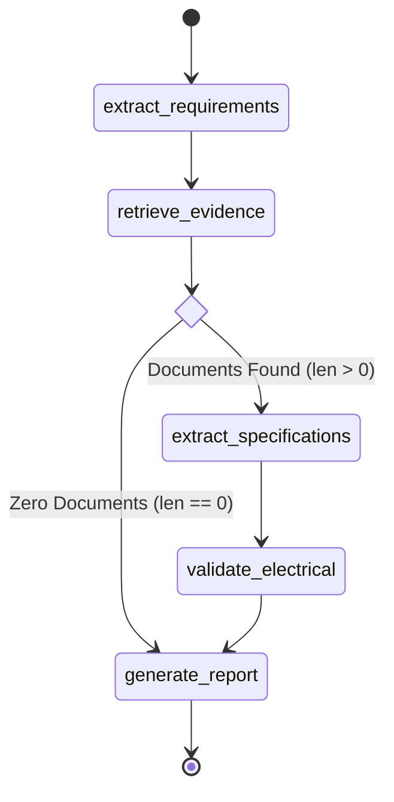

# CircuitMind AI — Technical Architecture & Engineering Specifications

This document provides an in-depth architectural breakdown of **CircuitMind AI**, an agentic AI electronics engineering copilot. It details the state machine design, multi-agent orchestration, hybrid retrieval pipeline, mathematical formulations, deterministic safety verification, and telemetry profiling.

---

## 1. System Overview & Core Philosophy

Electronic circuit design is safety-critical. Unlike generic software development where rapid iteration and soft failures can be tolerated, mistakes in hardware design result in physical damage: component burnout, latch-up, thermal runaway, or damaged test equipment.

Generic Large Language Models (LLMs) suffer from:
1. **Probabilistic Hallucination:** Fabricating pin numbers, voltage tolerances, or absolute maximum ratings.
2. **Arithmetic Incompetence:** Performing sloppy arithmetic calculations for Ohm's Law, thermal resistance, or quiescent dissipation.
3. **Unverifiable Claims:** Outputting circuit schematics without citing the exact datasheet revision, page number, and condition table.

CircuitMind AI resolves these challenges through a **deterministic-first, LLM-augmented architecture**:

```
                       ┌───────────────────────────────┐
                       │   Streamlit Frontend (UI)     │
                       │   Dark Navy Engineering Dashboard│
                       └───────────────┬───────────────┘
                                       │ HTTP / JSON
                                       ▼
                       ┌───────────────────────────────┐
                       │      FastAPI Backend API      │
                       │      Pre-warmed Lifespan      │
                       └───────────────┬───────────────┘
                                       │
                                       ▼
   ┌───────────────────────────────────────────────────────────────────────┐
   │                  LangGraph StateGraph Orchestrator                    │
   │                                                                       │
   │   [extract_requirements] ──► [retrieve_evidence]                      │
   │      (RequirementAgent)         (ResearchAgent)                       │
   │                                        │                              │
   │                              Evidence Found?                          │
   │                              ├── Yes ──► [extract_specifications]     │
   │                              │              (ComponentAgent)          │
   │                              │                     │                  │
   │                              │                     ▼                  │
   │                              │           [validate_electrical]        │
   │                              │              (ValidationAgent)         │
   │                              │                     │                  │
   │                              └── No ──┐            │                  │
   │                                       ▼            ▼                  │
   │                                    [generate_report]                  │
   │                                       (ReportAgent)                   │
   │                                             │                         │
   │                                             ▼                         │
   │                                           [END]                       │
   └───────────────────────────────────┬───────────────────────────────────┘
                                       │
            ┌──────────────────────────┴──────────────────────────┐
            ▼                                                     ▼
┌───────────────────────────────┐             ┌───────────────────────────────┐
│     Hybrid RAG Subsystem      │             │ Deterministic Physics Engine  │
│  - Dense: ChromaDB (all-MiniLM)│             │  - Ohm's Law (V = I * R)      │
│  - Sparse: BM25 Retriever     │             │  - Quiescent Power (P = V*I)  │
│  - Fusion: Reciprocal Rank    │             │  - Headroom (Vcc - Vsat)      │
│  - Local file fast-path       │             │  - ADC Compatibility Check    │
└───────────────────────────────┘             └───────────────────────────────┘
```

---

## 2. Multi-Agent StateGraph Workflow

The workflow is orchestrated using LangGraph's `StateGraph`, operating over a shared state schema (`CircuitMindState`).

### State Schema (`CircuitMindState`)

```python
class CircuitMindState(TypedDict):
    user_query: str                                  # Raw engineering prompt
    requirements: Dict[str, Any]                     # Parsed voltage, current, load, temp constraints
    retrieved_documents: List[Dict[str, Any]]        # Grounded chunks with source & page metadata
    component_information: Dict[str, Any]            # Verified electrical specs with citations
    validation_results: Dict[str, Any]               # Deterministic calculation cards & pass/fail statuses
    engineering_report: Dict[str, Any]               # Formatted report cards, warnings & disclaimers
    node_execution_times: Dict[str, float]           # Execution telemetry in milliseconds
    errors: List[str]                                # Non-fatal error logs
```

### The Five Agents

| Agent Node | Class | Core Responsibility | Deterministic vs Probabilistic |
| :--- | :--- | :--- | :--- |
| **`extract_requirements`** | `RequirementAgent` | Extracts explicit constraints (`target_supply_voltage_v`, `target_max_current_ma`, `adc_reference_v`, `adc_resolution_bits`, `min_temp_c`, `max_temp_c`, `load_impedance_ohms`) and identifies specific component variants (`LM35D`, `LM35A`, `LM35C`, `LM35CA`, `LM35DZ`) using robust regex supporting Unicode en-dash (`–`), em-dash (`—`), minus (`−`), hyphen (`-`), and `to`. Disambiguates sensor supply from ADC reference. Identifies missing requirements without guessing. | Deterministic (Regex / Parsing) |
| **`retrieve_evidence`** | `ResearchAgent` | Queries persistent vector store and keyword index using Hybrid RAG (Dense ChromaDB + Sparse BM25 + Reciprocal Rank Fusion $k=60$). Injects component part numbers and electrical terms into search queries. Preserves exact page numbers, PDF source, and chunk IDs. | Deterministic (Math / Scoring) |
| **`extract_specifications`** | `ComponentAgent` | Synthesizes verified electrical specifications from retrieved datasheet passages, mapping them to standard engineering classifications (`Recommended Operating Conditions`, `Absolute Maximum Ratings`, `Electrical Characteristics`, `Typical Characteristics`, `Guaranteed or tested limits`). Attaches source citations `[filename, p. X]`, numeric bounds (`min_val`, `max_val`), conditions, component variants, and verbatim `evidence_text`. Preserves official TI variant-specific temperature ranges (e.g. LM35D: 0°C to 100°C) and distinguishes typical quiescent current (56 µA at 25°C, 5V) from tested (67 µA) and guaranteed design limits (131 µA over temperature). | Grounded Extraction (Gemini / Rule-Fallback) |
| **`validate_electrical`** | `ValidationAgent` | Runs deterministic, physics-based engineering rules: Ohm's Law, quiescent power dissipation, voltage headroom, supply voltage operating limits, component variant operating temperature ratings (flags violations e.g. LM35D at 125°C), sensor transfer calculations at 0°C, 25°C, 100°C with nominal vs. tolerance bounds, static ADC saturation ($T_{sat}$), $N$-bit quantization ($V_{LSB}$ and temperature resolution per count), interface caveats (capacitive load damping $>50\text{ pF}$, AGND/DGND separation), and output load boundary checking. Generates `PASS`, `FAIL`, and `UNVERIFIED` check cards. **Scope Boundary:** Explicitly distinguishes static voltage compatibility from full ADC interface validation; dynamic SAR acquisition time, pin leakage, source impedance limits, and clamp protection remain `UNVERIFIED`. Design validity resolves strictly to `VALID`, `INVALID`, or `INCONCLUSIVE`, with the strict guarantee that a `FAIL` or safety violation always yields `INVALID` and is never overridden by `UNVERIFIED` checks. | 100% Deterministic (Physics Rules) |
| **`generate_report`** | `ReportAgent` | Assembles executive summary synchronized with validation status, requirements overview, verified specification tables with verbatim evidence and page citations, validation check summaries, warnings, and source citations. Appends mandatory preliminary engineering fabrication disclaimer. | Structured Synthesis |

### Conditional Routing Logic



When no relevant datasheet evidence is located in ChromaDB, the graph bypasses specification extraction and validation, routing straight to `generate_report`. This prevents false claims when evidence is absent.

---

## 3. Grounded Hybrid RAG Pipeline

CircuitMind AI combines dense vector embeddings with sparse term frequency matching to balance semantic understanding with exact part-number and electrical unit matching.

```
                  ┌───────────────────────────────┐
                  │    Engineering Search Query   │
                  └───────────────┬───────────────┘
                                  │
                  ┌───────────────┴───────────────┐
                  ▼                               ▼
       ┌─────────────────────┐         ┌─────────────────────┐
       │ Dense Vector Search │         │ Sparse BM25 Search  │
       │ ChromaDB + MiniLM   │         │ Token Match Engine  │
       └──────────┬──────────┘         └──────────┬──────────┘
                  │ Ranked List D                 │ Ranked List S
                  └───────────────┬───────────────┘
                                  │
                                  ▼
                     ┌─────────────────────────┐
                     │  Reciprocal Rank Fusion │
                     │       (RRF Score)       │
                     └────────────┬────────────┘
                                  │
                                  ▼
                     ┌─────────────────────────┐
                     │ Deduplicated Passages   │
                     │ Citing Filename & Page  │
                     └─────────────────────────┘
```

### Ingestion & Chunking
1. **PDF Parsing:** PyMuPDF (`fitz`) extracts clean text block by block, retaining the physical document page index.
2. **Sliding Window Chunking:** Chunks are created with target size $800$ characters and $150$ characters overlap, avoiding broken sentence boundaries.
3. **Metadata Preservation:** Every chunk retains:
   - `source`: PDF filename (e.g., `lm35.pdf`)
   - `page`: Exact 1-indexed page number
   - `part_number`: Identified component part number (e.g., `LM35`)
   - `chunk_id`: Unique deterministic hash `filename_pX_idx`

### Mathematical Formulation: Reciprocal Rank Fusion (RRF)

Standard vector search struggles with exact alphanumeric part numbers (e.g., `LM35DZ` vs `LM35AH`), while keyword search struggles with conceptual synonymy (e.g., "quiescent current" vs "supply current"). 

CircuitMind AI applies **Reciprocal Rank Fusion**:

$$RRF(d) = \sum_{m \in M} \frac{w_m}{k_{rrf} + r_m(d)}$$

Where:
- $M = \{\text{dense}, \text{sparse}\}$ is the set of retrieval models.
- $w_{\text{dense}} = 0.5$ and $w_{\text{sparse}} = 0.5$ are equal model weights.
- $k_{rrf} = 60$ is the standard smoothing constant preventing top-ranked dominance.
- $r_m(d)$ is the 1-based rank position of document $d$ within retriever $m$'s top candidate list.

If a document appears in both dense and sparse top rankings, its RRF score compounds, placing it at the top of the context window.

### Local Performance Measurements & Retriever Optimization

> **Benchmark Scope & Empirical Measurement Disclaimer:** All performance metrics reported below represent local measured results obtained on a Windows 11 development machine (Python 3.11.9, Intel Core i7, 16GB RAM). They serve as empirical performance indicators for developers, not guaranteed production SLAs or fixed cross-platform speedup multipliers. Actual latency varies based on CPU capabilities, disk I/O, cache warming, and Python runtime overhead.

In unoptimized cold-start environments, initializing `HuggingFaceEmbeddings` incurred up to **35.57 seconds** of measured latency due to `huggingface_hub` remote HTTP network checks triggering exponential backoff retries and socket timeouts in offline or restricted environments.

CircuitMind AI minimizes local request latency via three architectural mechanisms:
1. `local_files_only=True`: Instructs PyTorch to load cached model weights directly from the local Hugging Face disk cache, bypassing remote HTTP validation entirely. *(Note: Requires model weights to be pre-cached in the deployment environment; falls back gracefully to standard download if missing).*
2. **Singleton Retriever Factory (`get_retriever()`):** Keeps embedding weights, persistent ChromaDB collections, and BM25 indexes warm in memory across requests.
3. **Application Lifespan Pre-Warming:** FastAPI initializes the retriever before receiving incoming traffic.

#### Local Measured Benchmark Data
- **Pure Datasheet Retrieval (`POST /api/v1/retrieve`):** 5 consecutive live hybrid queries completed in **16.43 ms – 61.50 ms** (average **26.18 ms** local measured wall time).
- **Full 5-Agent Copilot Analysis (`POST /api/v1/analyze`):** 3 full workflow executions completed in **42.19 ms – 181.15 ms** wall time, with all five agents executing successfully in all three runs.
- **Cold-Start Distinction:** Distinguishes one-time startup initialization (~1.2s local disk load) from recurring warm retrieval queries (average 26.18 ms).
- **Test Suite Execution History:** The full regression suite contains 140 automated tests. The latest verified execution completed in **68.32 seconds** (140 passed, 1 warning). An earlier run under warm cache conditions completed in **16.73 seconds**; both achieved 100% pass rates.

### Gemini Configuration & Model Fallback
- `app/config.py` defines a code-level fallback of `gemini-2.5-flash` if `GEMINI_MODEL` is unset.
- `.env.example` and active `.env` specify `GEMINI_MODEL=gemini-3.8-flash`.
- Model availability and preview lifecycles depend on Google AI Studio account tier and region; users should verify that their specified model ID is active and authorized for their API key rather than assuming availability.

### Storage & Persistence Architecture
- **ChromaDB Storage:** ChromaDB is accessed via `chromadb.PersistentClient` rooted in `CHROMA_PERSIST_DIRECTORY` (`./data/processed/chromadb`).
- **Ephemeral Storage Risk:** In stateless serverless or container platforms without persistent storage volumes, restarting containers will destroy vector database directories, causing `/health` to report `vector_db_connected: false` ("degraded") until datasheets are re-ingested. Production deployments require mounted persistent volumes or external managed vector databases.

---

## 4. Deterministic Electrical Safety Engine

Unlike probabilistic models, CircuitMind AI delegates all math and safety checks to `ElectricalCalculator` and `ValidationAgent`.

### Implemented Physics Calculations

1. **Ohm's Law:**
   $$V = I \times R \quad \Longleftrightarrow \quad I = \frac{V}{R} \quad \Longleftrightarrow \quad R = \frac{V}{I}$$

2. **Quiescent Power Dissipation:**
   $$P_Q = V_{CC} \times I_Q$$
   *Example:* For $V_{CC} = 5.0\text{ V}$ and $I_Q = 60\ \mu\text{A}$ ($0.06\text{ mA}$):
   $$P_Q = 5.0 \times 0.06 \times 10^{-3} = 0.30\text{ mW}$$

3. **Voltage Headroom:**
   $$V_{\text{headroom}} = V_{\text{max\_recommended}} - V_{\text{target\_supply}}$$

4. **Sensor Output Voltage at Temperature & Tolerance Bounds:**
   For a linear temperature sensor with scale factor $S = 10\text{ mV/}^\circ\text{C}$:
   $$V_{\text{out\_nom}}(T) = T \times S$$
   $$V_{\text{out\_min}}(T) = T \times S - \text{Tol}_{\text{V}}, \quad V_{\text{out\_max}}(T) = T \times S + \text{Tol}_{\text{V}}$$
   - At $25^\circ\text{C}$: $V_{\text{out}} = 25 \times 0.010 = 0.250\text{ V}$
   - At $100^\circ\text{C}$: $V_{\text{out}} = 100 \times 0.010 = 1.000\text{ V}$

5. **ADC Compatibility, Clipping Saturation & Quantization:**
   $$\text{Status} = \begin{cases} \text{PASS}, & \text{if } V_{\text{out\_max}} \le V_{\text{ADC\_ref}} \\ \text{FAIL}, & \text{if } V_{\text{out\_max}} > V_{\text{ADC\_ref}} \end{cases}$$
   - **Clipping Saturation Temperature ($T_{\text{sat}}$):**
     $$T_{\text{sat}} = \frac{V_{\text{ADC\_ref}} \times 1000}{S}$$
     *Safety Significance:* If an engineer designs an LM35 sensor circuit with $V_{\text{ADC\_ref}} = 0.8\text{ V}$ for temperatures up to $100^\circ\text{C}$ ($V_{\text{out}} = 1.0\text{ V}$), the ADC saturates at $T_{\text{sat}} = 80^\circ\text{C}$, clipping all higher measurements. CircuitMind AI flags this as a **FAIL** and invalidates the design (`INVALID`).
   - **$N$-Bit Quantization Resolution ($V_{\text{LSB}}$ and $T_{\text{res}}$):**
     $$V_{\text{LSB}} = \frac{V_{\text{ADC\_ref}}}{2^N}, \quad T_{\text{res}} = \frac{V_{\text{LSB}}}{S}$$
     *Example:* For $V_{\text{ADC\_ref}} = 3.3\text{ V}$ and $N = 10\text{ bits}$: $V_{\text{LSB}} = \frac{3.3}{1024} \approx 3.22\text{ mV}$, yielding $T_{\text{res}} \approx 0.32^\circ\text{C}/\text{count}$.
   - **Static Voltage Compatibility vs. Complete ADC Interface Validation:**
     Calculating $V_{\text{out\_max}} \le V_{\text{ADC\_ref}}$ confirms that the sensor voltage output will not exceed the converter reference ceiling under static DC conditions. However, this check alone does **not** constitute complete ADC interface validation. Several crucial dynamic and mixed-signal parameters remain `UNVERIFIED` without explicit user circuitry models:
     - **Dynamic Acquisition Time ($t_{\text{acq}}$):** For SAR ADCs, the internal sampling capacitor ($C_{\text{sample}} \approx 4\text{ to }20\text{ pF}$) must charge within the acquisition window: $t_{\text{acq}} \ge (R_S + R_{\text{sw}}) C_{\text{sample}} \ln(2^{N+1})$.
     - **Driving Source Impedance ($R_S$):** Allowable source impedance is not a universal constant (e.g., 10 kΩ); it is fundamentally governed by the specific ADC's acquisition window ($t_{\text{acq}}$), sampling capacitance ($C_{\text{sample}}$), multiplexer switch on-resistance ($R_{\text{sw}}$), converter resolution ($N$ bits), and permissible settling error ($< \frac{1}{2}\text{ LSB}$). Without ADC-specific timing and input network parameters, driving impedance compatibility and settling performance remain classified as `UNVERIFIED`.
     - **Pin Input Leakage Current ($I_{\text{leak}}$):** Analog input leakage induces DC offset errors across high source resistances ($V_{\text{err}} = I_{\text{leak}} \times R_S$).
     - **Overvoltage & Transient Clamping:** Protection diodes or clamp networks required for fault conditions or power sequencing transients remain `UNVERIFIED`.

6. **Component Variant Operating Range Limits:**
   $$\text{Variant Status} = \begin{cases} \text{PASS}, & \text{if } T_{\text{min\_req}} \ge T_{\text{min\_variant}} \land T_{\text{max\_req}} \le T_{\text{max\_variant}} \\ \text{FAIL}, & \text{if } T_{\text{min\_req}} < T_{\text{min\_variant}} \lor T_{\text{max\_req}} > T_{\text{max\_variant}} \end{cases}$$
   *Example:* `LM35D` / `LM35DZ` is rated for $0^\circ\text{C}$ to $+100^\circ\text{C}$. Specifying an operating range up to $125^\circ\text{C}$ triggers a safety **FAIL**, immediately setting the circuit validation status to **INVALID**.

7. **Output Load Boundary Check (Absolute Maximum Rating):**
   $$I_{\text{load}} = \frac{V_{\text{out\_max}}}{R_{\text{load}}} \times 1000\text{ mA}$$
   $$\text{Status} = \begin{cases} \text{PASS}, & \text{if } I_{\text{load}} \le 10.0\text{ mA} \\ \text{FAIL}, & \text{if } I_{\text{load}} > 10.0\text{ mA} \end{cases}$$
   *Limitation & Scope Notice:* The 10 mA threshold is the LM35 **Absolute Maximum Rating** (damage threshold), NOT a recommended continuous operating load or guaranteed linear driving capability. Sourcing significant current causes internal die self-heating ($\Delta T = P_D \times \theta_{JA}$) that introduces measurement offset errors (the LM35 is designed for microamp-level loads for high accuracy). The validator only flags catastrophic overload exceeding 10 mA; it does not verify accuracy degradation or dynamic load regulation.

### Validation Status Resolution

| Individual Check Statuses | Overall Validation Status | Engineering Meaning |
| :--- | :--- | :--- |
| All checks `PASS` | `VALID` | Design satisfies all tested datasheet limits and electrical safety constraints. |
| At least one check `FAIL` | `INVALID` | Design violates absolute maximum ratings, operating range, or ADC input saturation. |
| Zero failures, but $\ge 1$ `UNVERIFIED` | `INCONCLUSIVE` | Critical parameters (e.g. load impedance, ADC reference, operating temperatures) were not specified or could not be grounded in evidence. |

---

## 5. Telemetry & Execution Profiling

Every node in the LangGraph state machine is instrumented with high-resolution wall-clock profiling using Python's `time.perf_counter()`.

Execution timings are stored in `state["node_execution_times"]` and returned in the API response:

```json
{
  "node_timings_ms": {
    "extract_requirements": 10.14,
    "retrieve_evidence": 16.89,
    "extract_specifications": 13.37,
    "validate_electrical": 0.39,
    "generate_report": 0.52
  }
}
```

The Streamlit frontend visualizes these timings in the **Agent Monitor** tab, providing engineering transparency.

---

## 6. Engineering Boundaries, Limitations & Disclaimers

### Mandatory Preliminary Engineering Disclaimer
CircuitMind AI provides automated engineering assistance and preliminary calculations based on digital datasheets. **All outputs, pin assignments, operating voltages, component recommendations, and reports are strictly preliminary and NOT fabrication-ready.** Hardware engineers must verify all designs against physical datasheets, perform SPICE simulations, and test prototype circuits on a physical breadboard using calibrated bench power supplies, digital multimeters, and oscilloscopes before manufacturing printed circuit boards (PCBs).

### Component Variant Uncertainty
When an engineering prompt specifies a generic part family (e.g., `LM35`) without an explicit orderable part suffix (`LM35A`, `LM35C`, `LM35CA`, `LM35D`, `LM35DZ`), the validator evaluates the query against the full-span base LM35 datasheet ratings (-55°C to 150°C) rather than assuming a restricted commercial sub-variant. However, it generates an explicit `GENERIC PART NUMBER UNCERTAINTY` warning alerting the engineer that commercial-grade devices (`LM35D` / `LM35DZ`) are strictly rated for 0°C to 100°C and will violate limits if deployed across the wider temperature span.

### Unsupported Dynamic ADC Sampling & Anti-Aliasing
CircuitMind AI deterministically evaluates DC full-scale input voltage range ($V_{\text{out\_max}} \le V_{\text{ADC\_ref}}$), clipping saturation temperatures ($T_{\text{sat}}$), and ideal quantization steps ($V_{\text{LSB}}$). However, dynamic ADC interface characteristics are **unsupported**:
- **Dynamic SAR Acquisition:** Sampling capacitor charge settling times ($R_{in} \cdot C_{sample}$) and multiplexer switching transients are not simulated.
- **Anti-Aliasing Filter Analysis:** Nyquist cut-off frequencies, low-pass filter roll-off attenuation, and phase margin distortion are not evaluated.
- **Mixed-Signal Noise & Layout:** PCB parasitic capacitance, ground bounce, and switching regulator noise coupling are outside the scope of the static validator.

