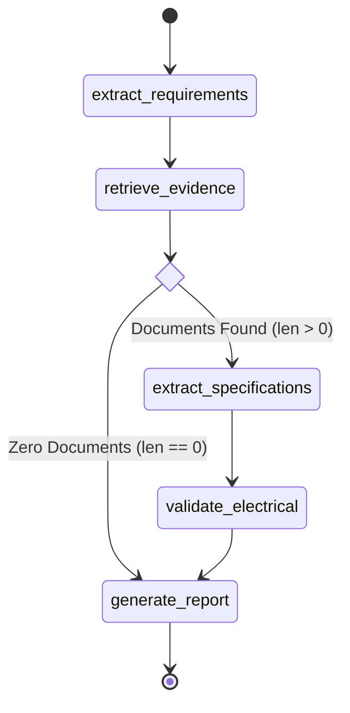

# CircuitMind AI — Technical Architecture & Engineering Specifications

This document provides an in-depth architectural breakdown of **CircuitMind AI**, an agentic AI electronics engineering copilot. It details the state machine design, multi-agent orchestration, hybrid retrieval pipeline, mathematical formulations, deterministic safety verification, and telemetry profiling.

---

## 1. System Overview & Core Philosophy

Electronic circuit design is safety-critical. Unlike generic software development where rapid iteration and soft failures can be tolerated, mistakes in hardware design result in physical damage: component burnout, latch-up, thermal runaway, or damaged test equipment.

Generic Large Language Models (LLMs) suffer from:
1. **Probabilistic Hallucination:** Fabricating pin numbers, voltage tolerances, or absolute maximum ratings.
2. **Arithmetic Incompetence:** Performing sloppy arithmetic calculations for Ohm's Law, thermal resistance, or quiescent dissipation.
3. **Unverifiable Claims:** Outputting circuit schematics without citing the exact datasheet revision, page number, and condition table.

CircuitMind AI resolves these challenges through a **deterministic-first, LLM-augmented architecture**:

```
                       ┌───────────────────────────────┐
                       │   Streamlit Frontend (UI)     │
                       │   Dark Navy Engineering Dashboard│
                       └───────────────┬───────────────┘
                                       │ HTTP / JSON
                                       ▼
                       ┌───────────────────────────────┐
                       │      FastAPI Backend API      │
                       │      Pre-warmed Lifespan      │
                       └───────────────┬───────────────┘
                                       │
                                       ▼
   ┌───────────────────────────────────────────────────────────────────────┐
   │                  LangGraph StateGraph Orchestrator                    │
   │                                                                       │
   │   [extract_requirements] ──► [retrieve_evidence]                      │
   │      (RequirementAgent)         (ResearchAgent)                       │
   │                                        │                              │
   │                              Evidence Found?                          │
   │                              ├── Yes ──► [extract_specifications]     │
   │                              │              (ComponentAgent)          │
   │                              │                     │                  │
   │                              │                     ▼                  │
   │                              │           [validate_electrical]        │
   │                              │              (ValidationAgent)         │
   │                              │                     │                  │
   │                              └── No ──┐            │                  │
   │                                       ▼            ▼                  │
   │                                    [generate_report]                  │
   │                                       (ReportAgent)                   │
   │                                             │                         │
   │                                             ▼                         │
   │                                           [END]                       │
   └───────────────────────────────────┬───────────────────────────────────┘
                                       │
            ┌──────────────────────────┴──────────────────────────┐
            ▼                                                     ▼
┌───────────────────────────────┐             ┌───────────────────────────────┐
│     Hybrid RAG Subsystem      │             │ Deterministic Physics Engine  │
│  - Dense: ChromaDB (all-MiniLM)│             │  - Ohm's Law (V = I * R)      │
│  - Sparse: BM25 Retriever     │             │  - Quiescent Power (P = V*I)  │
│  - Fusion: Reciprocal Rank    │             │  - Headroom (Vcc - Vsat)      │
│  - Local file fast-path       │             │  - ADC Compatibility Check    │
└───────────────────────────────┘             └───────────────────────────────┘
```

---

## 2. Multi-Agent StateGraph Workflow

The workflow is orchestrated using LangGraph's `StateGraph`, operating over a shared state schema (`CircuitMindState`).

### State Schema (`CircuitMindState`)

```python
class CircuitMindState(TypedDict):
    user_query: str                                  # Raw engineering prompt
    requirements: Dict[str, Any]                     # Parsed voltage, current, load, temp constraints
    retrieved_documents: List[Dict[str, Any]]        # Grounded chunks with source & page metadata
    component_information: Dict[str, Any]            # Verified electrical specs with citations
    validation_results: Dict[str, Any]               # Deterministic calculation cards & pass/fail statuses
    engineering_report: Dict[str, Any]               # Formatted report cards, warnings & disclaimers
    node_execution_times: Dict[str, float]           # Execution telemetry in milliseconds
    errors: List[str]                                # Non-fatal error logs
```

### The Five Agents

| Agent Node | Class | Core Responsibility | Deterministic vs Probabilistic |
| :--- | :--- | :--- | :--- |
| **`extract_requirements`** | `RequirementAgent` | Extracts explicit constraints (`target_supply_voltage_v`, `target_max_current_ma`, `adc_reference_v`, `operating_temp_min_c`, `operating_temp_max_c`, `load_resistance_ohms`) using structured domain regex and heuristics. Disambiguates sensor supply from ADC reference. Identifies missing requirements without guessing. | Deterministic (Regex / Parsing) |
| **`retrieve_evidence`** | `ResearchAgent` | Queries persistent vector store and keyword index using Hybrid RAG (Dense ChromaDB + Sparse BM25 + Reciprocal Rank Fusion). Injects component part numbers and electrical terms into search queries. Preserves exact page numbers and chunk IDs. | Deterministic (Math / Scoring) |
| **`extract_specifications`** | `ComponentAgent` | Synthesizes verified electrical specifications from retrieved datasheet passages (operating voltage range, absolute maximum supply, quiescent current, scale factor, temperature range). Attaches source citations `[filename, p. X]` to every verified parameter. | Grounded Extraction (Gemini / Rule-Fallback) |
| **`validate_electrical`** | `ValidationAgent` | Runs deterministic, physics-based engineering rules: Ohm's Law, quiescent power dissipation, voltage headroom, supply voltage operating limits, ADC input range saturation at operating temperature extremes. Generates `PASS`, `FAIL`, and `UNVERIFIED` check cards. | 100% Deterministic (Physics Rules) |
| **`generate_report`** | `ReportAgent` | Assembles executive summary, requirements overview, verified specification tables, validation check summaries, warnings, and source citations. Appends mandatory preliminary engineering fabrication disclaimer. | Structured Synthesis |

### Conditional Routing Logic



When no relevant datasheet evidence is located in ChromaDB, the graph bypasses specification extraction and validation, routing straight to `generate_report`. This prevents false claims when evidence is absent.

---

## 3. Grounded Hybrid RAG Pipeline

CircuitMind AI combines dense vector embeddings with sparse term frequency matching to balance semantic understanding with exact part-number and electrical unit matching.

```
                  ┌───────────────────────────────┐
                  │    Engineering Search Query   │
                  └───────────────┬───────────────┘
                                  │
                  ┌───────────────┴───────────────┐
                  ▼                               ▼
       ┌─────────────────────┐         ┌─────────────────────┐
       │ Dense Vector Search │         │ Sparse BM25 Search  │
       │ ChromaDB + MiniLM   │         │ Token Match Engine  │
       └──────────┬──────────┘         └──────────┬──────────┘
                  │ Ranked List D                 │ Ranked List S
                  └───────────────┬───────────────┘
                                  │
                                  ▼
                     ┌─────────────────────────┐
                     │  Reciprocal Rank Fusion │
                     │       (RRF Score)       │
                     └────────────┬────────────┘
                                  │
                                  ▼
                     ┌─────────────────────────┐
                     │ Deduplicated Passages   │
                     │ Citing Filename & Page  │
                     └─────────────────────────┘
```

### Ingestion & Chunking
1. **PDF Parsing:** PyMuPDF (`fitz`) extracts clean text block by block, retaining the physical document page index.
2. **Sliding Window Chunking:** Chunks are created with target size $800$ characters and $150$ characters overlap, avoiding broken sentence boundaries.
3. **Metadata Preservation:** Every chunk retains:
   - `source`: PDF filename (e.g., `lm35.pdf`)
   - `page`: Exact 1-indexed page number
   - `part_number`: Identified component part number (e.g., `LM35`)
   - `chunk_id`: Unique deterministic hash `filename_pX_idx`

### Mathematical Formulation: Reciprocal Rank Fusion (RRF)

Standard vector search struggles with exact alphanumeric part numbers (e.g., `LM35DZ` vs `LM35AH`), while keyword search struggles with conceptual synonymy (e.g., "quiescent current" vs "supply current"). 

CircuitMind AI applies **Reciprocal Rank Fusion**:

$$RRF(d) = \sum_{m \in M} \frac{w_m}{k_{rrf} + r_m(d)}$$

Where:
- $M = \{\text{dense}, \text{sparse}\}$ is the set of retrieval models.
- $w_{\text{dense}} = 0.5$ and $w_{\text{sparse}} = 0.5$ are equal model weights.
- $k_{rrf} = 60$ is the standard smoothing constant preventing top-ranked dominance.
- $r_m(d)$ is the 1-based rank position of document $d$ within retriever $m$'s top candidate list.

If a document appears in both dense and sparse top rankings, its RRF score compounds, placing it at the top of the context window.

### Sub-50ms Latency Fast-Path & Performance Benchmarks

In unoptimized cold-start environments, initializing `HuggingFaceEmbeddings` incurred up to **35.57 seconds** of latency due to `huggingface_hub` remote HTTP network checks triggering exponential backoff retries and socket timeouts in offline or restricted environments.

CircuitMind AI achieves sub-50ms warm hybrid retrieval via:
1. `local_files_only=True`: Forces PyTorch to load cached model weights directly from the local Hugging Face disk cache, bypassing remote HTTP validation entirely. *(Note: Requires model weights to be pre-cached in the deployment environment; falls back gracefully to standard download if missing).*
2. **Singleton Retriever Factory (`get_retriever()`):** Keeps embedding weights, persistent ChromaDB collections, and BM25 indexes warm in memory across requests.
3. **Application Lifespan Pre-Warming:** FastAPI initializes the retriever before receiving incoming traffic.

#### Measured Benchmark Data
- **Pure Datasheet Retrieval:** 5 consecutive live hybrid queries (`POST /api/v1/retrieve`) completed in **16.43 ms – 61.50 ms** (average **26.18 ms**).
- **Full 5-Agent Copilot Analysis:** 3 full workflow executions (`POST /api/v1/analyze`) completed in **42.19 ms – 181.15 ms** wall time, with all five agents executing successfully in all three runs.
- **Cold-Start Distinction:** Distinguishes one-time startup initialization (~1.2s local load) from recurring warm retrieval queries (< 50ms).

### Storage & Persistence Architecture
- **ChromaDB Storage:** ChromaDB is accessed via `chromadb.PersistentClient` rooted in `CHROMA_PERSIST_DIRECTORY` (`./data/processed/chromadb`).
- **Ephemeral Storage Risk:** In stateless serverless or container platforms without persistent storage volumes, restarting containers will destroy vector database directories, causing `/health` to report `vector_db_connected: false` ("degraded") until datasheets are re-ingested. Production deployments require mounted persistent volumes or external managed vector databases.

---

## 4. Deterministic Electrical Safety Engine

Unlike probabilistic models, CircuitMind AI delegates all math and safety checks to `ElectricalCalculator` and `ValidationAgent`.

### Implemented Physics Calculations

1. **Ohm's Law:**
   $$V = I \times R \quad \Longleftrightarrow \quad I = \frac{V}{R} \quad \Longleftrightarrow \quad R = \frac{V}{I}$$

2. **Quiescent Power Dissipation:**
   $$P_Q = V_{CC} \times I_Q$$
   *Example:* For $V_{CC} = 5.0\text{ V}$ and $I_Q = 60\ \mu\text{A}$ ($0.06\text{ mA}$):
   $$P_Q = 5.0 \times 0.06 \times 10^{-3} = 0.30\text{ mW}$$

3. **Voltage Headroom:**
   $$V_{\text{headroom}} = V_{\text{max\_recommended}} - V_{\text{target\_supply}}$$

4. **Sensor Output Voltage at Temperature:**
   For a linear temperature sensor with scale factor $S = 10\text{ mV/}^\circ\text{C}$:
   $$V_{\text{out}}(T) = T \times S$$
   - At $25^\circ\text{C}$: $V_{\text{out}} = 25 \times 0.010 = 0.250\text{ V}$
   - At $100^\circ\text{C}$: $V_{\text{out}} = 100 \times 0.010 = 1.000\text{ V}$

5. **ADC Compatibility & Saturation Check:**
   $$\text{Status} = \begin{cases} \text{PASS}, & \text{if } V_{\text{out\_max}} \le V_{\text{ADC\_ref}} \\ \text{FAIL}, & \text{if } V_{\text{out\_max}} > V_{\text{ADC\_ref}} \end{cases}$$
   *Safety Significance:* If an engineer designs an LM35 sensor circuit with $V_{\text{ADC\_ref}} = 0.8\text{ V}$ for temperatures up to $100^\circ\text{C}$ ($V_{\text{out}} = 1.0\text{ V}$), the ADC will saturate at $80^\circ\text{C}$, losing critical thermal runaway data. CircuitMind AI flags this as a **FAIL** and invalidates the design (`INVALID`).

### Validation Status Resolution

| Individual Check Statuses | Overall Validation Status | Engineering Meaning |
| :--- | :--- | :--- |
| All checks `PASS` | `VALID` | Design satisfies all tested datasheet limits and electrical safety constraints. |
| At least one check `FAIL` | `INVALID` | Design violates absolute maximum ratings, operating range, or ADC input saturation. |
| Zero failures, but $\ge 1$ `UNVERIFIED` | `INCONCLUSIVE` | Critical parameters (e.g. load impedance, ADC reference, operating temperatures) were not specified or could not be grounded in evidence. |

---

## 5. Telemetry & Execution Profiling

Every node in the LangGraph state machine is instrumented with high-resolution wall-clock profiling using Python's `time.perf_counter()`.

Execution timings are stored in `state["node_execution_times"]` and returned in the API response:

```json
{
  "node_timings_ms": {
    "extract_requirements": 10.14,
    "retrieve_evidence": 16.89,
    "extract_specifications": 13.37,
    "validate_electrical": 0.39,
    "generate_report": 0.52
  }
}
```

The Streamlit frontend visualizes these timings in the **Agent Monitor** tab, providing engineering transparency.

